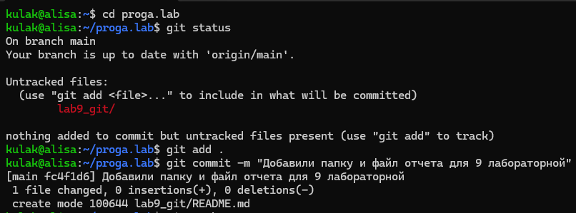
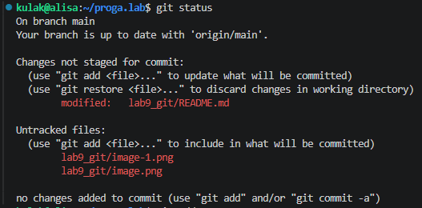
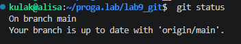
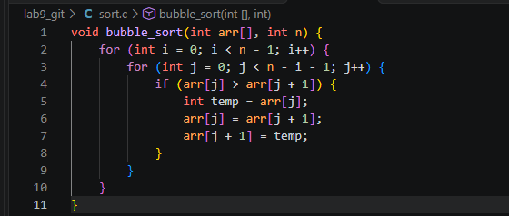
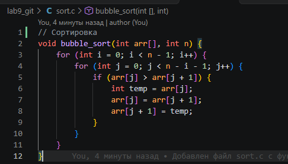
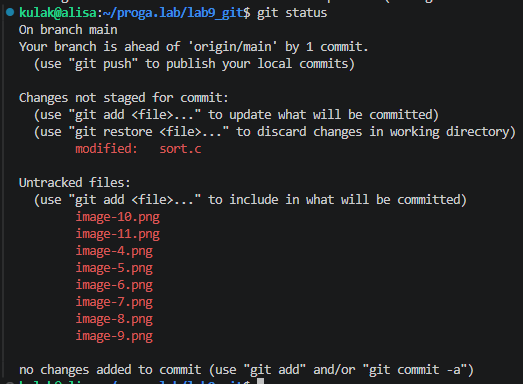
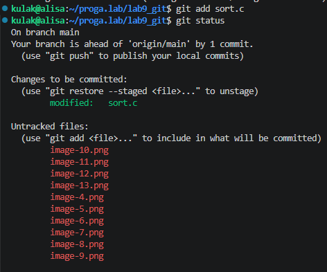
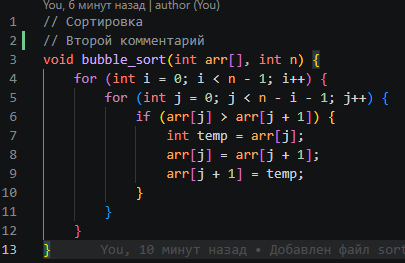

Создали папку для выполнения лабораторной работы №9
В папке добавили файл README.md
Закоммитили изменение
 
Отправили в репозиторий изменения 
Ввели логин и Personal Access Token (PAT) для авторизации в аккаунте GitHab

Работа через VS Code

На оценку 3:
1. Используйте git status, чтобы узнать, на какой ветке вы находитесь.

2. Как выглядит git log? 

3. Создайте файл sort.c и вставьте туда код функции любой сортировки 
(только ф-ия сортировки) 

4. Как сейчас выглядит вывод git status? 

5. Добавьте файл в область stage (add) 
6. Как сейчас выглядит git status? 

7. Закоммитить файл в репозиторий 

8. Как сейчас выглядит git status? 

9. Добавить комментарий с любым текстом в этот же файл 

10.  Как сейчас выглядит git status? 
   
11.  Добавьте (add) изменение файла 
12.  Как сейчас выглядит git status? 

13.  Измените файл еще раз (можно добавить еще комментарий или убрать 
старый)

14.  Сделайте коммит 

15.  Как сейчас выглядит status? Журнал (log)?

16.  Добавьте в stage и закоммитьте последнее изменение

17.  Запушим на удаленный репо (git push) 
